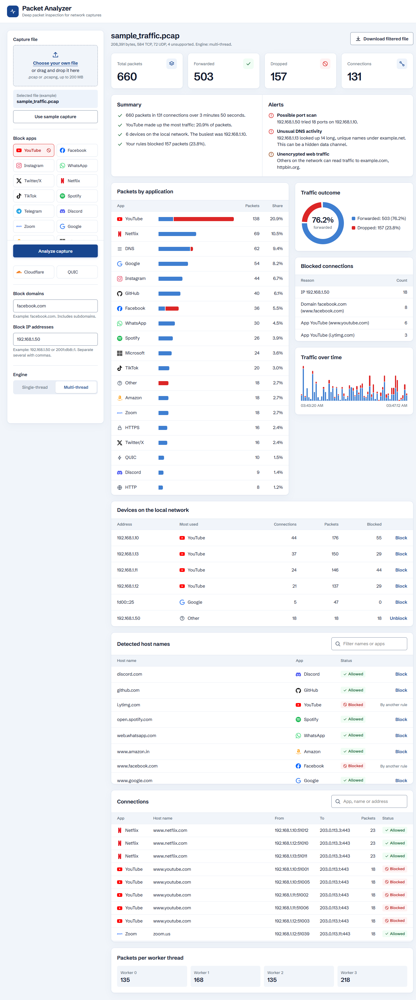

# Packet Analyzer

**See what is in a network recording, privately, on your own computer.**

Open a capture saved by Wireshark. Packet Analyzer shows which apps and websites were used, warns about suspicious traffic, and can remove the traffic you choose into a new, filtered file.



## What it does

| Feature | Example |
|---|---|
| Identifies apps and websites | YouTube, Netflix, github.com |
| Blocks by app, website or IP address | Remove YouTube traffic from the file |
| Summarises in plain English | "YouTube made up the most traffic: 20.9% of packets." |
| Warns about risky traffic | Possible port scan, unusual DNS, unencrypted websites |
| Shows devices, connections and a timeline | Which device was busiest, and when |
| Saves the result | Download the filtered capture |

It works on **saved recordings**. It does not watch or block your live internet, and it does not decrypt anything.

## Get started (Windows)

### 1. Install once

| You need | Where to get it |
|---|---|
| g++ with C++17 | [MSYS2](https://www.msys2.org/): install it, run `pacman -S mingw-w64-ucrt-x86_64-gcc` in its UCRT64 terminal, then add `C:\msys64\ucrt64\bin` to your PATH |
| Python 3.9 or newer | [python.org](https://www.python.org/downloads/) |
| Wireshark (optional) | [wireshark.org](https://www.wireshark.org/), to record your own traffic |

### 2. Build

Open PowerShell in this folder:

```powershell
powershell -ExecutionPolicy Bypass -File build.ps1
```

### 3. Open the web page

```powershell
python ui\server.py
```

Go to <http://127.0.0.1:8000>. An example capture opens by itself.

1. Select **Choose your own file**, or keep the example.
2. Select the apps to block, or type a website or IP address.
3. Select **Analyze capture**.
4. Read the summary and alerts, then select **Download filtered file** if you want it.

Press Ctrl+C in PowerShell to stop.

<details>
<summary><b>Linux or macOS</b> (not tested by hand)</summary>

```bash
cmake -S . -B build -DCMAKE_BUILD_TYPE=Release
cmake --build build
python3 ui/server.py
```

</details>

<details>
<summary><b>Something went wrong?</b></summary>

| Message | What to do |
|---|---|
| `g++` is not recognized | Add `C:\msys64\ucrt64\bin` to PATH and open a new PowerShell |
| Engine not built | Run step 2 |
| Port 8000 is already in use | Run `python ui\server.py 8080` and open <http://127.0.0.1:8080> |
| Unsupported link type | The capture is not in Ethernet format; record a normal Wi-Fi or Ethernet connection |
| Few website names | Much modern traffic hides them; see [Limits](#limits) |

</details>

## Use it from the command line

```powershell
.\build\dpi_simple.exe data\test_dpi.pcap build\output.pcap --block-app YouTube --block-domain facebook.com
```

| Option | Effect |
|---|---|
| `--block-app <app>` | Block an app (`--help` lists them) |
| `--block-domain <domain>` | Block a website, its subdomains and its DNS lookups |
| `--block-ip <address>` | Block traffic to or from an IPv4 or IPv6 address |
| `--json <file>` | Also save the report as JSON |
| `--lbs <n>`, `--fps <n>` | Thread counts, 1 to 64 (`dpi_mt` only) |

Block options can be repeated. `dpi_simple` uses one thread and `dpi_mt` uses several; both give the same results. See an [example report](docs/sample_output.txt).

## How it works

```
Web page  ->  Python server  ->  C++ engine  ->  report + filtered file

Inside the engine, for every packet:
read  ->  decode addresses  ->  find its connection  ->  find the app  ->  check rules  ->  keep or drop
```

HTTPS is encrypted, but the first message of a connection usually shows the website's name. The engine reads that name. [docs/LEARN.md](docs/LEARN.md) explains every step.

| Built with | For |
|---|---|
| C++17, standard library only | The engine and its threads |
| Python, standard library only | The local web server, tests and sample files |
| HTML, CSS, JavaScript | The web page, with no framework |

## Find your way around

| Folder | Contents |
|---|---|
| [src](src), [include](include) | C++ engine: code and headers |
| [ui](ui) | Web page and its server |
| [tests](tests) | Automatic tests |
| [data](data) | Two sample captures, both generated |
| [tools](tools) | Programs that generate the samples |
| [docs](docs) | Documentation |

| Read this | If you want to |
|---|---|
| [docs/LEARN.md](docs/LEARN.md) | Understand the code, step by step, from zero |
| [docs/TESTING.md](docs/TESTING.md) | See how it was tested, and how fast it is |

## Limits

- **Recordings only**, in Ethernet format (`.pcap` or `.pcapng`). The filtered file is always `.pcap`.
- **Hidden names:** website names sent by QUIC or Encrypted Client Hello are not visible.
- **Alerts are simple rules.** They can miss attacks and can be wrong.
- **Only TCP and UDP are inspected.** Other packets are kept, so rules do not apply to them.
- **Large captures use more memory,** because connections are remembered until the end.

[docs/TESTING.md](docs/TESTING.md#technical-limits) lists the technical limits.

## Privacy

Captures are processed on your computer and are not sent to the internet. Record only networks you own or have permission to monitor, and do not publish captures: they can show websites, addresses and unencrypted passwords.

## Licence

[MIT](LICENSE). You may use and change this code.

## Acknowledgements

- Typeface: Schibsted Grotesk ([SIL Open Font License](ui/fonts/LICENSE.txt)). App logos: [Simple Icons](https://simpleicons.org/); trademarks belong to their owners.
